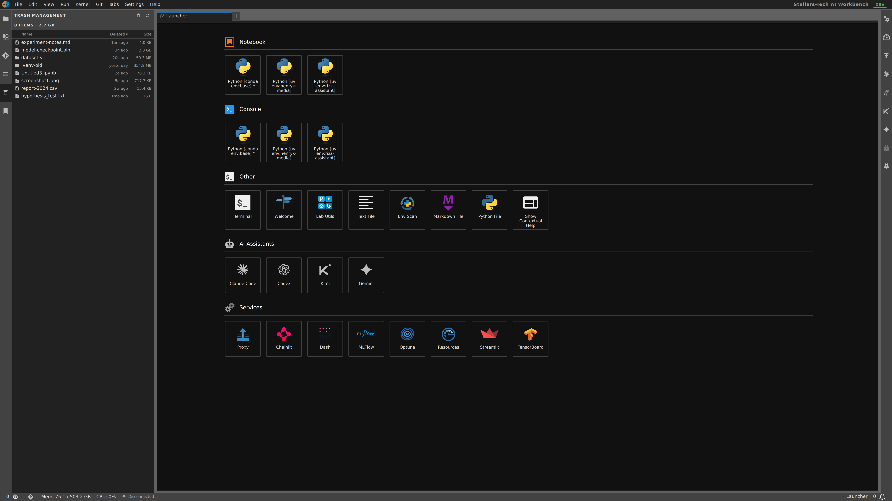

# jupyterlab_trash_mgmt_extension

[](https://github.com/stellarshenson/jupyterlab_trash_mgmt_extension/actions/workflows/build.yml)
[](https://www.npmjs.com/package/@stellarshenson/jupyterlab-trash-mgmt-extension)
[](https://pypi.org/project/jupyterlab-trash-mgmt-extension/)
[](https://pepy.tech/project/jupyterlab-trash-mgmt-extension)
[](https://jupyterlab.readthedocs.io/en/stable/)
[](https://kolomolo.com)
[](https://www.paypal.com/donate/?hosted_button_id=B4KPBJDLLXTSA)

> [!TIP]
> This extension is part of the [stellars_jupyterlab_extensions](https://github.com/stellarshenson/stellars_jupyterlab_extensions) metapackage. Install all Stellars extensions at once: `pip install stellars_jupyterlab_extensions`

A dedicated left panel for managing your JupyterLab trash. See what's taking up space, restore files you need, or empty the bin entirely.



## Features

- **Trash panel in sidebar** - Accessible alongside file browser, kernels, git, and extensions panels
- **Storage usage display** - See how much space deleted files occupy
- **Every trash in one list** - The main list shows the items of the XDG trash, `/home/cache`, every user's home trash and every location trash together; each row restores and deletes in its own trash
- **Show Volumes** - Right-click the panel header, or use the command palette, to show each trash as a collapsible section with its own item count, size and a trash button that empties only that trash; off by default and remembered in the browser
- **Trash on other file systems** - The trash folder of the notebook root and of every folder in `c.TrashManagement.locations` is one of the trashes (see [Configuration](#configuration))
- **Mount-safe delete** - Deleting or emptying a trashed folder stops at a file system mounted inside it; that entry stays in the trash with an error naming the mount
- **Range of the clean** - two commands in the command palette: Clean All Sources empties every source; Clean Workspace removes only entries whose original path lies under the workspace
- **Individual item management** - Remove or restore specific files from trash
- **Folder navigation** - Open a trashed folder and restore or remove single items inside it
- **Keyboard control** - Tab to the list, move with the arrow keys, select with Space, open a folder with Enter and reach Restore and Delete with Shift+F10
- **Motion that carries meaning** - the loading ring keeps turning under every system preference, while the refresh button stays static
- **Large trash** - Emptying tens of thousands of items no longer blocks the rest of the lab
- **Empty bin** - The header trash button empties every trash at once
- **Server-side integration** - Python backend for reliable trash operations

## Installation

Requires JupyterLab 4.6 or higher.

```bash
pip install jupyterlab_trash_mgmt_extension
```

## Uninstall

```bash
pip uninstall jupyterlab_trash_mgmt_extension
```

## Configuration

send2trash can put a deleted item into a trash folder at the top of another file system: `<folder>/.Trash-<uid>`, or `<folder>/.Trash/<uid>` when `.Trash` is a sticky directory that is not a symbolic link. The XDG trash (the main list) and the trash folder of the notebook root are always monitored. The server option `c.TrashManagement.locations` adds folders; the main list includes the items of each one's trash folder, and with Show Volumes on the panel shows it as a section after the notebook root, in option order, labelled with that folder.

- Default `[]`: the XDG trash and the notebook root only
- `~` is expanded; a relative path resolves against the server `root_dir`
- A folder with no trash folder gets no section
- A folder that repeats the notebook root or the XDG trash gets no second section
- No mount table is read and no mount below a folder is visited
- A change needs a server restart

Add folders in `jupyter_server_config.py`:

```python
c.TrashManagement.locations = ['~/.cache', '/mnt/nas-shared']
```

---

_Built because I kept running out of disk space and blaming everything except my own hoarding of failed notebooks._
